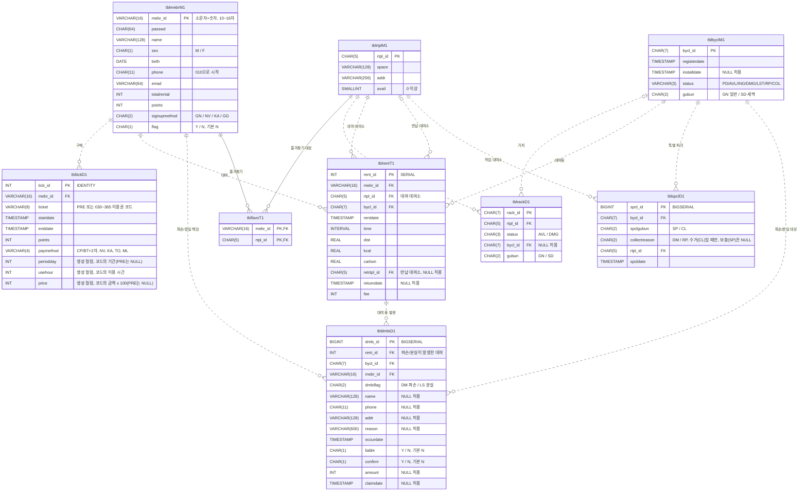

# bicycle_rental ERD (PostgreSQL)

`postgresql_create_ddl.sql` 기준으로 그린 ERD입니다. 실선은 FK가 PK의 일부인 관계, 점선은 일반 FK 관계입니다.

## 관계 정리

| 부모 | 자식 | FK 컬럼 | 비고 |
|---|---|---|---|
| tblmebrM1 | tbltickD1 | mebr_id | 회원 1명이 이용권 여러 개 |
| tblmebrM1 | tblrentT1 | mebr_id | |
| tblmebrM1 | tbldmlsD1 | mebr_id | |
| tblmebrM1 | tblfavoT1 | mebr_id | PK의 일부 |
| tblrtplM1 | tblfavoT1 | rtpl_id | PK의 일부 |
| tblrtplM1 | tblrackD1 | rtpl_id | |
| tblrtplM1 | tblrentT1 | rtpl_id | 대여한 대여소 |
| tblrtplM1 | tblrentT1 | retrtpl_id | 반납한 대여소, 반납 전에는 NULL |
| tblrtplM1 | tblspclD1 | rtpl_id | |
| tblbyclM1 | tblrackD1 | bycl_id | 빈 거치대는 NULL |
| tblbyclM1 | tblrentT1 | bycl_id | |
| tblbyclM1 | tblspclD1 | bycl_id | |
| tblbyclM1 | tbldmlsD1 | bycl_id | |
| tblrentT1 | tbldmlsD1 | rent_id | 파손/분실이 발생한 대여. mebr_id, bycl_id는 이 대여와 같은 값을 반정규화로 함께 저장 |

## 참고

- tblfavoT1은 회원과 대여소의 다대다 관계를 풀어주는 연결 테이블입니다.
- tblrentT1이 tblrtplM1을 두 번 참조합니다(rtpl_id, retrtpl_id).
- tblrackD1.bycl_id에는 UNIQUE가 없어서, DDL만 보면 한 자전거가 여러 거치대에 들어갈 수 있습니다. ERD에서도 1:N으로 그렸습니다.
